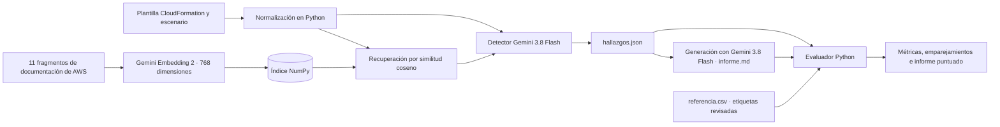

# Detección de configuraciones inseguras en CloudFormation con Gemini y RAG

Réplica funcional para el taller del flujo propuesto por Toprani y Madisetti (2025). El notebook analiza plantillas AWS CloudFormation, recupera documentación de seguridad y genera hallazgos en JSON y recomendaciones en Markdown. El evaluador compara los hallazgos con una referencia preparada antes de la corrida.

El experimento formal consistió en **tres repeticiones sobre las mismas diez plantillas**. Cinco contienen, en conjunto, veinte incumplimientos anotados. Las otras cinco sirven como controles dentro del catálogo evaluado. El corpus combina ejemplos públicos de AWS y casos adaptados. El análisis se ejecuta en Google Colab con CPU y llamadas reales a la API de Gemini. [Artículo original](https://ieeexplore.ieee.org/document/10965635) · [Ejemplos de AWS Control Tower](https://docs.aws.amazon.com/controltower/latest/controlreference/)

## Archivos

| Archivo | Contenido |
|---|---|
| [`Replica_Toprani_2025.ipynb`](Replica_Toprani_2025.ipynb) | Notebook de Colab con la sección 4 adaptada a Gemini. Incluye el código, el corpus, la documentación de AWS y la configuración inicial. |
| [`Referencias_Toprani_Evaluador.zip`](Referencias_Toprani_Evaluador.zip) | Etiquetas por fase y procedencia de los casos adaptados. Se usa para puntuar y cerrar la referencia formal. |
| `Codigo_y_corpus_Toprani.zip` | Copia opcional para inspeccionar el módulo Python, los prompts, las plantillas, los escenarios y el índice documental de entrada. La configuración inicial del paquete identifica Bedrock y la sección 4 del notebook establece Gemini antes de la ejecución real. |
| `resultados/` | Evidencia de las corridas del taller. Incluye el resumen formal, manifiestos, métricas y emparejamientos de las tres repeticiones. |

## Flujo implementado



La recuperación selecciona hasta tres fragmentos por tipo de recurso, con un máximo de doce por plantilla. El detector recibe la plantilla original, el resumen normalizado, los controles, el contexto del caso y los fragmentos recuperados. El generador redacta el informe a partir de los hallazgos. El evaluador empareja cada alerta por `plantilla_id`, `recurso_logico_id` y `control_id`.

## Cómo ejecutar en Google Colab

### 1. Preparar Drive y Gemini

1. Descarga el notebook de este repositorio y ábrelo en [Google Colab](https://colab.research.google.com/) mediante **Archivo → Abrir cuaderno → Subir**. Selecciona CPU en la configuración del entorno de ejecución.
2. Crea `Evaluador_Toprani` en **Mi unidad** y sube allí `Referencias_Toprani_Evaluador.zip`. El modo `evaluar` extrae los CSV cuando los necesita. Conserva esa carpeta separada de la carpeta del estudio durante la detección.
3. Crea o recupera tu clave en [Google AI Studio](https://aistudio.google.com/apikey). En el panel **Secrets** de Colab, guárdala como `GEMINI_API_KEY` y habilita su acceso para este notebook.
4. Ejecuta la sección 1 y autoriza el montaje de Drive. La segunda celda extrae los archivos incluidos y prepara `Mi unidad/Replica_Toprani_2025/`. Si ya tienes otra versión de esta réplica, selecciona una carpeta de estudio nueva con `DIRECTORIO_ESTUDIO`.

### 2. Verificar una plantilla y el piloto

Edita estas opciones en la sección 1. Ejecuta el notebook desde el inicio para cada fila de la tabla.

| Objetivo | `MODO` | `FASE` | `ID_CORRIDA` | `CONFIRMAR_REVISION_FORMAL` |
|---|---|---|---|---|
| Verificar el flujo con una simulación | `simular` | `smoke` | `smoke-prueba` | `False` |
| Analizar una plantilla con Gemini | `detectar` | `smoke` | `smoke-gemini` | `False` |
| Puntuar la prueba con Gemini | `evaluar` | `smoke` | `smoke-gemini` | `False` |
| Analizar tres casos de piloto | `detectar` | `piloto` | `piloto-gemini` | `False` |
| Puntuar el piloto | `evaluar` | `piloto` | `piloto-gemini` | `False` |

La simulación funciona sin clave de API. La prueba real inicial registra los modelos Gemini en la configuración del estudio. El piloto cubre un caso sin infracción del control SSH, un incumplimiento directo y uno que depende de una lista de prefijos. Tras evaluar `smoke-gemini`, abre `runs/smoke-gemini/S01/informe_puntuado.md` en la carpeta del estudio.

### 3. Repetir la comparación formal

1. Ejecuta primero la prueba real o el piloto. Así se guarda la configuración de Gemini antes de cerrar la referencia.
2. En `Evaluador_Toprani/formal/referencia.csv`, revisa las etiquetas contra las plantillas y sus escenarios. Completa `revisor` y `fecha_revision` en todas las filas. Usa formato `AAAA-MM-DD` y conserva el CSV UTF-8 delimitado por comas.
3. Ejecuta con `MODO = 'evaluar'`, `FASE = 'formal'` y `CONFIRMAR_REVISION_FORMAL = True`. Espera el mensaje **Referencia cerrada** en la sección 8.
4. Ejecuta con `MODO = 'detectar'`, `FASE = 'formal'`, `ID_CORRIDA = 'formal-gemini'` y `CONFIRMAR_REVISION_FORMAL = False`. La sección 5–7 muestra una línea por repetición. Cada línea debe listar diez plantillas como `completa`.
5. Cambia a `MODO = 'evaluar'` y conserva la fase, el ID y la confirmación en `False`. El resultado agregado queda en `runs/formal-gemini-resumen.md`.

Para reanudar una corrida, conserva su ID y su configuración. El notebook verifica los archivos guardados y retoma las etapas pendientes. Si cambias el corpus, el modelo o los prompts, usa otro ID y vuelve a cerrar la referencia para esa configuración.

## Resultados de la corrida del taller

| Métrica | Toprani y Madisetti (2025) | Réplica con Gemini |
|---|---:|---:|
| Verdaderos positivos | 17 | 20 por repetición |
| Falsos positivos | 3 | 0 por repetición |
| Falsos negativos | 3 | 0 por repetición |
| Precisión | 0,85 | 1,00 |
| Recall | 0,85 | 1,00 |
| F1 | 0,85 | 1,00 |
| Tiempo medio comparable por plantilla | 85,10 s | 15,56 s |

Las repeticiones reprodujeron los mismos conteos de detección. Sus tiempos medios por plantilla fueron **15,56 s**, **15,06 s** y **16,06 s**. El tiempo comparable abarca recuperación, detección y generación del informe. La comparación con el artículo es histórica porque el corpus, los modelos y la implementación difieren. Los resultados describen este corpus y pueden variar al repetir las llamadas.

Los manifiestos registran el modelo, la versión de documentos y los parámetros de cada corrida. En el notebook base, la última línea del resumen puede mostrar el nombre de Sonnet como texto fijo. Para identificar el modelo ejecutado, consulta `config.text_model` y `config.embedding_model` en el `manifiesto.json` de la corrida.

La evidencia se organiza así. Los archivos se obtienen de `Mi unidad/Replica_Toprani_2025/runs/` después de evaluar las tres repeticiones.

```text
resultados/
├── formal-gemini-resumen.md
├── formal-gemini-resumen.json
├── formal-gemini-r1/
│   ├── manifiesto.json
│   ├── metricas.json
│   └── emparejamientos.csv
├── formal-gemini-r2/  # Los mismos tres archivos
└── formal-gemini-r3/  # Los mismos tres archivos
```

## Pruebas complementarias

- **Calidad de las recomendaciones.** Revisar las acciones de `remediacion.csv` junto con `informe.md`, `hallazgos.json` y `recuperacion.json`. Calificar corrección, especificidad, respaldo documental y adecuación al contexto. La rúbrica del taller de 0 a 4 amplía la revisión cualitativa del artículo.
- **Actualización documental.** La fase `actualizacion` permite comparar la base inicial con una variante que incorpora el anuncio de AWS Secrets Manager. Los resultados de esa fase se presentan por separado. [Anuncio de AWS](https://aws.amazon.com/blogs/security/introducing-an-enhanced-version-of-the-aws-secrets-manager-transform-awssecretsmanager-2024-09-16/)

## Referencia

Toprani, D., y Madisetti, V. K. (2025). *LLM Agentic Workflow for Automated Vulnerability Detection and Remediation in Infrastructure-as-Code*. IEEE Access, 13, 69175–69181. [DOI 10.1109/ACCESS.2025.3560911](https://doi.org/10.1109/ACCESS.2025.3560911).
